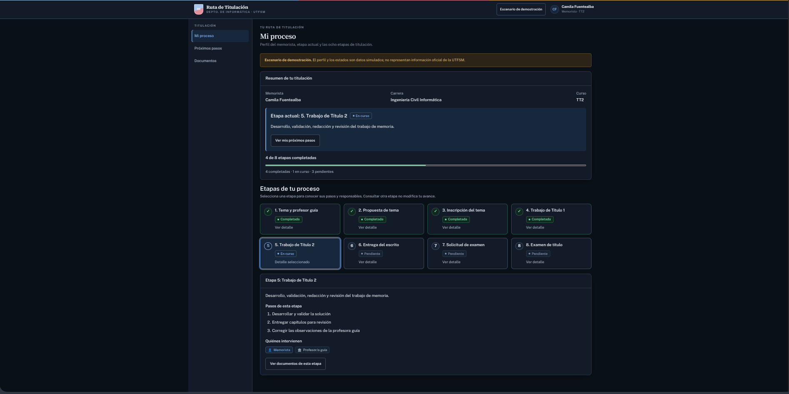
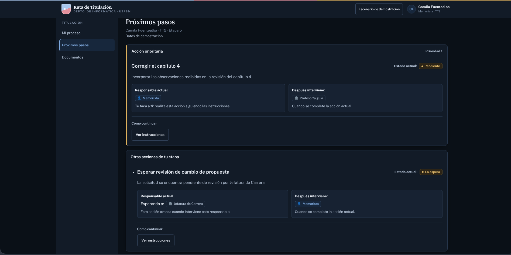
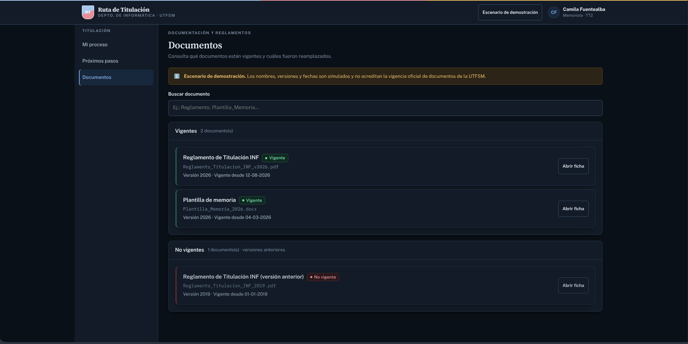
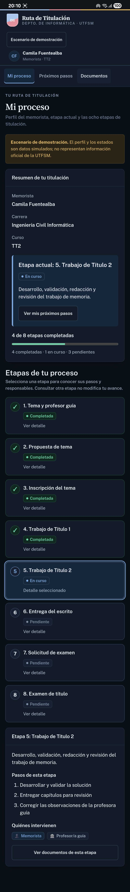
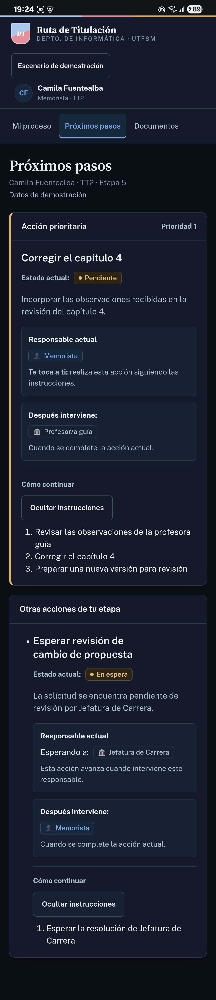
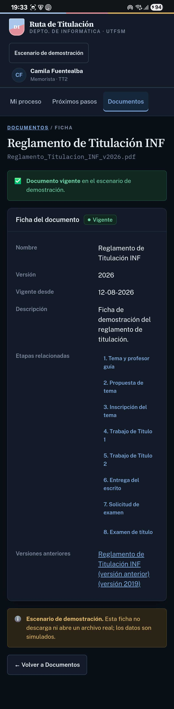

# Informe MVP — Ruta de Titulación

**Curso:** Diseño de Interfaces Usuarias, INF322 2026-2

**Repositorio:** https://github.com/friquelmel9/INF322-Proyecto.git

| Módulo | Integrante |
|---|---|
| A — Rutas y layout | Sebastian Duran Valde|
| B — Datos y componentes de estado | Facundo Riquelme |
| C — Estado del proceso (H1) | Cristóbal Martínez |
| D — Próxima acción (H2) | Cristian Quintanilla |
| E — Documentos (H5) | Williams Ajata Castillo |
| F — Componentes auxiliares, pruebas y entrega | José Joaquín Felipe Alvarado Toro |

### Consideraciones Previas

Todos los nombres, fechas, versiones y estados mostrados son un **escenario de demostración** y no constituyen información oficial extraida de la UTFSM.

## 1. Descripción

Ruta de Titulación es un prototipo en React que orienta a un memorista durante el proceso de las asignaturas TT1–TT2. El caso de prueba es Camila Fuentealba, memorista de TT2 en etapa 5. 

El proyecto no cuenta con backend: los datos se importan desde `src/data/`.

La idea principal del proyecto es trabajar en una pagina web que cumpla con las necesidades de los estudiantes de TT1-TT2 ya que la interfaz actual es bastante confusa y la presencia de la aplicacion web actual es casi inexistente.

## 2. Metas

### H1 — Estado del proceso (`/proceso`)

**Qué permite:** Ver en qué etapa del proceso está el memorista, distinguir las etapas completadas, la actual y las pendientes, y consultar qué implica cada una y quién interviene.

**Flujo:** Abrir `/proceso` → ver la etapa 5 como actual → distinguir las etapas 1–4 completadas y 6–8 pendientes → seleccionar una etapa.

### H2 — Próxima acción y responsables (`/pendientes`)

**Qué permite:** Saber qué debe hacer ahora el memorista, si es su turno o está esperando a un tercero, y quién interviene después.

**Flujo:** Abrir `/pendientes` → identificar «Corregir el capítulo 4» → ver «Te toca a ti» → desplegar las instrucciones → leer «Después interviene: Profesor/a guía».

### H5 — Documentos vigentes (`/documentos`)

**Qué permite:** Buscar documentos, distinguir los vigentes de los no vigentes y, desde una versión antigua, llegar a la versión que la reemplazó.

**Flujo:** Abrir `/documentos` → buscar «Reglamento» → abrir la ficha de la versión anterior → seleccionar «Ver versión vigente» → se abre `/documentos/reglamento-2026`.

### Capturas

#### Escritorio

  
    
  
    
  

#### Dispositivo Movil

  
  
  

